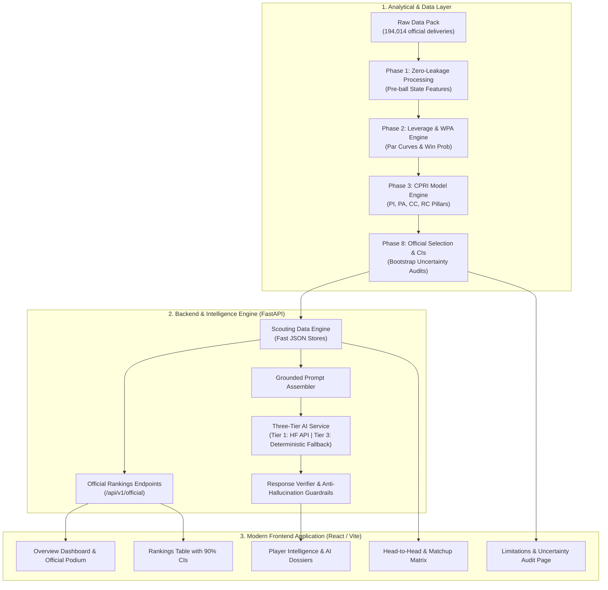

# SupeRR Intelligence — AI-Powered Cricket Pressure Analytics Platform

[](https://www.python.org/)
[](https://fastapi.tiangolo.com/)
[](https://react.dev/)
[](https://www.typescriptlang.org/)
[]()
[](./LICENSE)

**SupeRR Intelligence** is an advanced, evidence-grounded cricket scouting and clutch performance platform built for **SupeRR Selector Season 2 (Round 1)**.

It replaces naive aggregates (averages, raw strike rates) with delivery-level contextual state modeling, pressure index quantification, Win Probability Added (WPA), and Bayesian reliability shrinkage into the **Clutch Performance Rating Index (CPRI)**, layered with a **Three-Tier AI Scouting Intelligence Engine** and Rajasthan Royals visual identity.

---

## 1. Problem Statement & Motivation

Traditional cricket statistics treat every delivery identically: a single off the first ball of an innings is credited the same as a single required off the final ball of a chase. 

**SupeRR Intelligence solves three core limitations in T20 analytics:**
1. **Leverage Neglect:** Quantifies pressure dynamically using 1st innings par trajectories and 2nd innings required run rates, wickets in hand, and ball-by-ball WPA.
2. **Small-Sample Distortion:** Applies empirical Bayesian shrinkage and bootstrap rank confidence intervals (90% CI) to distinguish persistent clutch mastery from sample variance.
3. **Format Normalization:** Incorporates format-conditioned delivery expectations to evaluate dual-format players across both IPL and T20 International cricket fairly.

---

## 2. Official Competition Submission (Phase 8 Frozen Baseline)

The authoritative competition submission is frozen in **CPRI-v1.0.0-PROD-FREEZE**. Single-tournament slices serve as contextual secondary league views.

### Official Top 10 Batters

| Rank | Player | Unified CPRI | 90% Bootstrap CI | Confidence Tier | Evidence Scope | Pressure Balls |
| :---: | :--- | :---: | :---: | :---: | :---: | :---: |
| **1** | **Matthew Wade** | **85.36** | [1, 22] | Exploratory | Dual-Format | 191 |
| **2** | **Tim David** | **82.44** | [1, 19] | High Confidence | Dual-Format | 476 |
| **3** | **Suryakumar Yadav** | **81.42** | [2, 25] | High Confidence | Dual-Format | 749 |
| **4** | **Reeza Hendricks** | **77.45** | [2, 49] | High Confidence | Dual-Format | 398 |
| **5** | **Rinku Singh** | **77.18** | [1, 51] | High Confidence | Dual-Format | 342 |
| **6** | **Phil Salt** | **76.96** | [2, 46] | High Confidence | Dual-Format | 358 |
| **7** | **Romario Shepherd** | **75.33** | [2, 47] | High Confidence | Dual-Format | 309 |
| **8** | **Namboori Tilak Varma** | **74.81** | [3, 49] | High Confidence | Dual-Format | 496 |
| **9** | **Dinesh Karthik** | **74.54** | [3, 44] | High Confidence | Dual-Format | 288 |
| **10** | **Ravindra Jadeja** | **73.70** | [3, 56] | High Confidence | Dual-Format | 370 |

### Official Top 10 Bowlers

| Rank | Player | Unified CPRI | 90% Bootstrap CI | Confidence Tier | Evidence Scope | Pressure Balls |
| :---: | :--- | :---: | :---: | :---: | :---: | :---: |
| **1** | **Mitchell Santner** | **79.84** | [2, 36] | High Confidence | Dual-Format | 511 |
| **2** | **Sufiyan Muqeem** | **78.78** | [1, 74] | Exploratory | T20I-Only | 151 |
| **3** | **Rashid Khan** | **77.90** | [2, 33] | High Confidence | Dual-Format | 871 |
| **4** | **Jamie Overton** | **76.92** | [1, 71] | Exploratory | T20I-Only | 168 |
| **5** | **Matheesha Pathirana** | **75.77** | [4, 49] | High Confidence | IPL-Only | 569 |
| **6** | **Sunil Narine** | **75.63** | [3, 52] | High Confidence | Dual-Format | 511 |
| **7** | **Mohammad Nawaz** | **75.51** | [2, 60] | High Confidence | Dual-Format | 316 |
| **8** | **Jasprit Bumrah** | **73.36** | [3, 67] | High Confidence | Dual-Format | 606 |
| **9** | **Varun Chakravarthy** | **73.02** | [3, 68] | High Confidence | Dual-Format | 585 |
| **10** | **Yuzvendra Chahal** | **73.01** | [3, 48] | High Confidence | Dual-Format | 674 |

> **Uncertainty & Tier Classification:** Players with $\ge 300$ pressure balls and bounded CIs are categorized as **High Confidence**. Outliers with elite rate stats but $<250$ deliveries (e.g. Wade [1, 22], Muqeem [1, 74], Overton [1, 71]) are categorized as **Exploratory**. Full sensitivity details: [`docs/methodology/ADAPTABILITY_FORMULA_AND_SENSITIVITY.md`](docs/methodology/ADAPTABILITY_FORMULA_AND_SENSITIVITY.md).

---

## 3. System Architecture



---

## 4. Quick Start & Setup

### Prerequisites
- Python 3.10+ (Tested up to Python 3.14.3 64-bit)
- Node.js 18+ & npm
- Windows, Linux, or macOS

### 1. Installation
```bash
# Clone the repository
git clone https://github.com/CodePraneesh/SuperRR.git
cd SuperRR

# Install Python backend dependencies
pip install -r requirements.txt

# Install frontend dependencies
cd frontend && npm install && cd ..
```

### 2. Configure Environment (Optional)
```bash
cp .env.example .env
```
Edit `.env` and set `HF_TOKEN=your_token` if using Hugging Face inference. If omitted, the system operates completely offline using **Tier 3 (Deterministic Python Fallback)**.

### 3. Build Stores & Run Tests
```bash
# Build the official Phase 8 scouting store
python scripts/build_official_store.py

# Run all 214 automated tests
python run_all_tests_suite.py
```

### 4. Start the Application
- **Backend API Server**:
  ```bash
  uvicorn backend.app.main:app --reload --host 0.0.0.0 --port 8000
  ```
  Interactive API docs: [http://localhost:8000/docs](http://localhost:8000/docs)

- **Frontend Dashboard**:
  ```bash
  cd frontend && npm run dev
  ```
  Application UI: [http://localhost:5173](http://localhost:5173)

Alternatively, use the unified automation script:
```bash
bash scripts/run_all.sh all
```

---

## 5. Raw Data Pack Requirements & Reproducibility

The repository includes pre-built JSON stores in `output/phase4/data/` allowing full backend and frontend execution immediately upon cloning.

To re-run Phase 1 from raw source files:
1. Place the official competition data archive `6af458274c1e8_data_pack.zip` into the project root.
2. Unpack into `data/` (`train.csv` and `matches.csv`).
3. Run `python supeRR_phase1_pipeline.py`.
4. Fingerprint verification:
   - Total Matches: 883 (867 ball-data matches, 16 abandoned)
   - Official Scope Deliveries: 194,014 (excludes 30 emerging matches / 6,985 balls)
   - Deliverable SHA-256 hashes: [`output/phase8_ranking_reconsideration/reproducibility_manifest.json`](output/phase8_ranking_reconsideration/reproducibility_manifest.json)

---

## 6. Test Suite & Verification Metrics

SupeRR Intelligence maintains an exhaustive test suite with **214 passing unit tests**:
- **Phase 1 Data Validation:** 16 tests (`test_phase1_validation.py`)
- **Phase 2–10 Engine & API Tests:** 198 tests (`tests/test_*.py`)
- **Total Combined Tests:** **214 tests, 0 failures, 0 errors**

Run the full test suite with:
```bash
python run_all_tests_suite.py
```

---

## 7. Core REST API Endpoints

| Method | Endpoint | Description |
| :--- | :--- | :--- |
| `GET` | `/api/v1/official/rankings` | Authoritative official Phase 8 Top 10 for both Batters and Bowlers with 90% CIs |
| `GET` | `/api/v1/official/batters` | Official Top 10 Batters + contender candidates |
| `GET` | `/api/v1/official/bowlers` | Official Top 10 Bowlers + contender candidates |
| `GET` | `/api/v1/official/player/{name}` | Player official standing, CPRI, and rank CI |
| `GET` | `/api/v1/players/{scope}/{role}` | Contextual single-tournament cohort players (IPL / T20I) |
| `GET` | `/api/v1/players/{scope}/{role}/{name}` | Full player profile, CPRI components, and exposure |
| `GET` | `/api/v1/players/{scope}/{role}/{name}/splits` | Situational innings phase and pressure splits |
| `GET` | `/api/v1/scouting/matchup/{scope}/{batter}/{bowler}` | H2H encounter data with sample size tier warnings |
| `POST` | `/api/v1/scouting/compare` | Multi-dimensional side-by-side player comparison |
| `POST` | `/api/v1/scouting/ask` | Evidence-grounded natural language analytics QA |
| `GET` | `/api/v1/health` | Service health, inference tier availability, and stores status |

---

## 8. Documentation Index

- **Master Documentation Index:** [`docs/README.md`](docs/README.md)
- **Adaptability Formula & Sensitivity:** [`docs/methodology/ADAPTABILITY_FORMULA_AND_SENSITIVITY.md`](docs/methodology/ADAPTABILITY_FORMULA_AND_SENSITIVITY.md)
- **Official Selection Report:** [`docs/methodology/PHASE_8_OFFICIAL_SELECTION_REPORT.md`](docs/methodology/PHASE_8_OFFICIAL_SELECTION_REPORT.md)
- **Final Methodology Report:** [`docs/methodology/PHASE_8_FINAL_METHODOLOGY_REPORT.md`](docs/methodology/PHASE_8_FINAL_METHODOLOGY_REPORT.md)
- **Temporal Robustness & ML Evaluation:** [`docs/methodology/PHASE_9_2_TEMPORAL_ROBUSTNESS_REPORT.md`](docs/methodology/PHASE_9_2_TEMPORAL_ROBUSTNESS_REPORT.md)
- **Final Ranking Validation (Phase 10):** [`docs/methodology/PHASE_10_FINAL_ASSESSMENT_REPORT.md`](docs/methodology/PHASE_10_FINAL_ASSESSMENT_REPORT.md)
- **Cloud Deployment Guide:** [`DEPLOYMENT.md`](./DEPLOYMENT.md)
