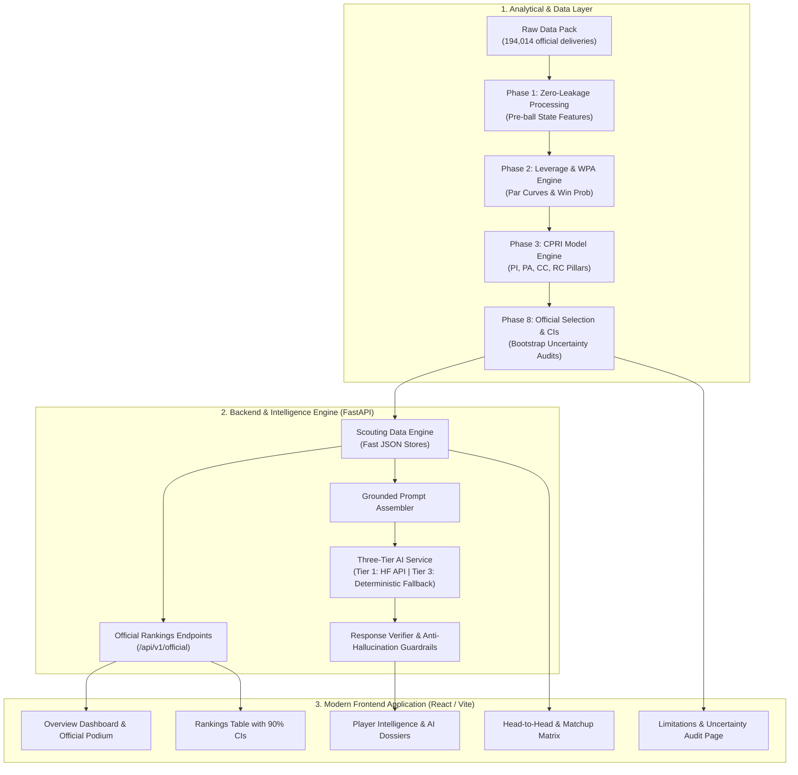

# SupeRR Intelligence — AI-Powered Cricket Pressure Analytics Platform

[](https://www.python.org/)
[](https://fastapi.tiangolo.com/)
[](https://react.dev/)
[](https://www.typescriptlang.org/)
[]()
[](./LICENSE)

**SupeRR Intelligence** is an advanced, evidence-grounded cricket scouting and clutch performance platform built for **SupeRR Selector Season 2 (Round 1)**.

It replaces naive aggregates (averages, raw strike rates) with delivery-level contextual state modeling, pressure index quantification, Win Probability Added (WPA), and Bayesian reliability shrinkage into the **Clutch Performance Rating Index (CPRI)**, layered with a **Three-Tier AI Scouting Intelligence Engine** and Rajasthan Royals visual identity.

---

## 1. Problem Statement & Motivation

Traditional cricket statistics treat every delivery identically: a single off the first ball of an innings is credited the same as a single required off the final ball of a chase. 

**SupeRR Intelligence solves three core limitations in T20 analytics:**
1. **Leverage Neglect:** Quantifies pressure dynamically using 1st innings par trajectories and 2nd innings required run rates, wickets in hand, and ball-by-ball WPA.
2. **Small-Sample Distortion:** Applies empirical Bayesian shrinkage and bootstrap rank confidence intervals (90% CI) to distinguish persistent clutch mastery from sample variance.
3. **Format Normalization:** Incorporates format-conditioned delivery expectations to evaluate dual-format players across both IPL and T20 International cricket fairly.

---

## 2. Official Competition Submission (Phase 13: Uniform Minimum-Evidence Floor)

> **CRITICAL METHODOLOGICAL DISCLOSURE (POST-HOC RULE)**:
> The **uniform minimum-evidence floor of $N_{\text{pressure balls}} \ge 250$ in the evaluated role** is an **explicitly POST-HOC rule** formulated and implemented after inspecting the initial Phase 8 results. It was **NOT pre-registered**.
> 
> **Motivation**: In the unconstrained Phase 8 baseline, small-sample rate variance produced high rank instability: Sufiyan Muqeem (#2 Bowler, 151 balls) exhibited a 90% rank interval of [1, 74]; Jamie Overton (#4 Bowler, 168 balls) had [1, 71]; Matthew Wade (#1 Batter, 191 balls) had [1, 22]. Applying a uniform floor of $\ge 250$ pressure deliveries ensures the official Unstop submission represents robustly battle-tested clutch performers. All CPRI scores, component weights, and pressure definitions ($PI \ge 50$) are **100% unchanged**; ranks are simply re-numbered among eligible players.
>
> The full formal rule specification is documented in [`docs/methodology/v6/EVIDENCE_FLOOR_RULE.md`](docs/methodology/v6/EVIDENCE_FLOOR_RULE.md).

### Official Top 10 Batters (Phase 13: $\ge 250$ Pressure Balls)

| Rank | Player | Unified CPRI | 90% Bootstrap CI | Confidence Tier | Evidence Scope | Pressure Balls |
| :---: | :--- | :---: | :---: | :---: | :---: | :---: |
| **1** | **Tim David** | **82.44** | [1, 16] | Heavy Volume (Tier 1) | Dual-Format | 476 |
| **2** | **Suryakumar Yadav** | **81.42** | [2, 20] | Heavy Volume (Tier 1) | Dual-Format | 749 |
| **3** | **Reeza Hendricks** | **77.45** | [1, 32] | Heavy Volume (Tier 1) | T20I-Only | 378 |
| **4** | **Rinku Singh** | **77.18** | [1, 37] | Heavy Volume (Tier 1) | Dual-Format | 457 |
| **5** | **Phil Salt** | **76.96** | [1, 41] | Moderate Volume (Tier 2) | Dual-Format | 261 |
| **6** | **Romario Shepherd** | **75.33** | [2, 34] | Heavy Volume (Tier 1) | Dual-Format | 428 |
| **7** | **Namboori Tilak Varma** | **74.81** | [3, 34] | Heavy Volume (Tier 1) | Dual-Format | 777 |
| **8** | **Dinesh Karthik** | **74.54** | [1, 43] | Moderate Volume (Tier 2) | Dual-Format | 277 |
| **9** | **Ravindra Jadeja** | **73.70** | [5, 44] | Heavy Volume (Tier 1) | Dual-Format | 467 |
| **10** | **Shashank Singh** | **72.83** | [2, 46] | Heavy Volume (Tier 1) | IPL-Only | 327 |

### Official Top 10 Bowlers (Phase 13: $\ge 250$ Pressure Balls)

| Rank | Player | Unified CPRI | 90% Bootstrap CI | Confidence Tier | Evidence Scope | Pressure Balls |
| :---: | :--- | :---: | :---: | :---: | :---: | :---: |
| **1** | **Mitchell Santner** | **79.84** | [1, 26] | Heavy Volume (Tier 1) | Dual-Format | 653 |
| **2** | **Rashid Khan** | **77.90** | [1, 24] | Heavy Volume (Tier 1) | Dual-Format | 970 |
| **3** | **Matheesha Pathirana** | **75.77** | [2, 34] | Heavy Volume (Tier 1) | Dual-Format | 557 |
| **4** | **Sunil Narine** | **75.63** | [2, 32] | Heavy Volume (Tier 1) | IPL-Only | 511 |
| **5** | **Mohammad Nawaz** | **75.51** | [1, 26] | Heavy Volume (Tier 1) | T20I-Only | 301 |
| **6** | **Jasprit Bumrah** | **73.36** | [2, 44] | Heavy Volume (Tier 1) | Dual-Format | 606 |
| **7** | **Varun Chakravarthy** | **73.02** | [3, 32] | Heavy Volume (Tier 1) | Dual-Format | 892 |
| **8** | **Yuzvendra Chahal** | **73.01** | [2, 32] | Heavy Volume (Tier 1) | Dual-Format | 859 |
| **9** | **Abrar Ahmed** | **72.93** | [1, 47] | Moderate Volume (Tier 2) | T20I-Only | 291 |
| **10** | **Mohit Sharma** | **72.71** | [1, 52] | Moderate Volume (Tier 2) | IPL-Only | 282 |

### Sensitivity Across Delivery Floor Thresholds (Post-hoc)

| Pressure Floor | Eligible Batters | Batters Dropped from Baseline | Batters Promoted to Top 10 | Eligible Bowlers | Bowlers Dropped from Baseline | Bowlers Promoted to Top 10 |
| :---: | :---: | :--- | :--- | :---: | :--- | :--- |
| **None (Phase 8 Baseline)** | 256 | None | None | 212 | None | None |
| **≥ 150 Balls** | 116 | None | None | 114 | None | None |
| **≥ 200 Balls** | 86 | Matthew Wade (191b, #1) | Shashank Singh (327b, #11) | 90 | Sufiyan Muqeem (151b, #2), Jamie Overton (168b, #4) | Abrar Ahmed (291b, #11), Mohit Sharma (282b, #12) |
| **≥ 250 Balls (Official)** | **64** | **Matthew Wade (191b, #1)** | **Shashank Singh (327b, #11)** | **66** | **Sufiyan Muqeem (151b, #2), Jamie Overton (168b, #4)** | **Abrar Ahmed (291b, #11), Mohit Sharma (282b, #12)** |
| **≥ 300 Balls** | 44 | Wade (191b), Salt (261b), Karthik (277b) | Shashank Singh (#11), Ashutosh Sharma (#12), Klaasen (#13) | 48 | Muqeem (151b), Overton (168b), Abrar (291b), Mohit (282b) | Arshdeep Singh (#13), Harshal Patel (#14) |
| **≥ 400 Balls** | 20 | Wade, Salt, Karthik, Hendricks (378b), Shashank (327b) | Klaasen (#13), Pooran (#14), Miller (#16) | 26 | Muqeem, Overton, Nawaz (301b), Abrar, Mohit | Arshdeep (#13), Harshal (#14), Bhuvneshwar (#15) |

### Supplementary Pre-Floor Baseline (Phase 8 Frozen)

The unconstrained Phase 8 baseline remains permanently preserved and verifiable:
- **Top 10 Batters (Pre-Floor)**: Matthew Wade (191b, 85.36), Tim David (476b, 82.44), Suryakumar Yadav (749b, 81.42), Reeza Hendricks (378b, 77.45), Rinku Singh (457b, 77.18), Phil Salt (261b, 76.96), Romario Shepherd (428b, 75.33), Namboori Tilak Varma (777b, 74.81), Dinesh Karthik (277b, 74.54), Ravindra Jadeja (467b, 73.70).
- **Top 10 Bowlers (Pre-Floor)**: Mitchell Santner (653b, 79.84), Sufiyan Muqeem (151b, 78.78), Rashid Khan (970b, 77.90), Jamie Overton (168b, 76.92), Matheesha Pathirana (557b, 75.77), Sunil Narine (511b, 75.63), Mohammad Nawaz (301b, 75.51), Jasprit Bumrah (606b, 73.36), Varun Chakravarthy (892b, 73.02), Yuzvendra Chahal (859b, 73.01).

---

## 3. System Architecture



---

## 4. Quick Start & Setup

### Prerequisites
- Python 3.10+ (Tested up to Python 3.14.3 64-bit)
- Node.js 18+ & npm
- Windows, Linux, or macOS

### 1. Installation & Environment Setup
```bash
# Clone the repository
git clone https://github.com/CodePraneesh/SuperRR.git
cd SuperRR

# Create and activate virtual environment
python -m venv .venv
# Windows:
.\.venv\Scripts\activate
# Linux / macOS:
source .venv/bin/activate

# Pinned-version setup (Recommended for exact numerical reproduction):
pip install -r requirements.lock

# Alternatively, standard unpinned installation:
# pip install -r requirements.txt

# Install frontend dependencies
cd frontend && npm install && cd ..
```

### 2. Configure Environment (Optional)
```bash
cp .env.example .env
```
Edit `.env` and set `HF_TOKEN=your_token` if using Hugging Face inference. If omitted, the system operates completely offline using **Tier 3 (Deterministic Python Fallback)**.

### 3. Build Stores, Verify Manifest & Run Tests
```bash
# 1. Build the official Phase 8 scouting store
python scripts/build_official_store.py

# 2. Verify deliverable cryptographic hashes (Must return 17/17 MATCH)
python scripts/verify_manifest.py

# 3. Verify submission integrity, concordance, and ranking invariants
python scripts/verify_submission.py

# 4. Run automated test suite
python -m pytest tests test_phase1_validation.py -q -rs

# 5. Build frontend production bundle
cd frontend && npm run build && cd ..
```

### 4. Start the Application
- **Backend API Server**:
  ```bash
  uvicorn backend.app.main:app --reload --host 0.0.0.0 --port 8000
  ```
  Interactive API docs: [http://localhost:8000/docs](http://localhost:8000/docs)

- **Frontend Dashboard**:
  ```bash
  cd frontend && npm run dev
  ```
  Application UI: [http://localhost:5173](http://localhost:5173)

Alternatively, use the unified automation script:
```bash
bash scripts/run_all.sh all
```

---

## 5. Raw Data Pack Requirements & Reproducibility

The repository includes pre-built JSON stores in `output/phase4/data/` allowing full backend and frontend execution immediately upon cloning.

To re-run Phase 1 and the full analytical pipeline from raw source files:
1. Place the official competition data archive `6af458274c1e8_data_pack.zip` into the project root (or provide its path).
2. Ensure pinned dependencies are installed: `pip install -r requirements.lock`.
3. Run the automated end-to-end reproduction script:
   ```bash
   bash scripts/reproduce_phase8.sh [path/to/6af458274c1e8_data_pack.zip]
   # or on Windows:
   scripts\reproduce_phase8.bat [path\to\6af458274c1e8_data_pack.zip]
   # or via Makefile:
   make reproduce-phase8
   ```
   This script deterministically executes:
   - Environment check (`python scripts/check_environment.py`)
   - Phase 1 ingestion: `python supeRR_phase1_pipeline.py --zip "$ZIP_PATH" --out output`
   - Phase 2 ML generators with `PYTHONPATH=.`:
     - `python ml/phase2/pressure_validation.py`
     - `python ml/phase2/model_evaluation.py`
     - `python ml/phase2/wpa_evaluation.py`
   - Phase 8 selection recalculation: `python scripts/execute_phase8_analysis.py`
   - Verification: `python scripts/verify_manifest.py` and `python scripts/verify_submission.py`
4. Fingerprint verification:
   - Total Matches: 883 (867 ball-data matches, 16 abandoned)
   - Official Scope Deliveries: 194,014 (excludes 30 emerging matches / 6,985 balls)
   - Deliverable SHA-256 hashes: [`output/phase8_ranking_reconsideration/reproducibility_manifest.json`](output/phase8_ranking_reconsideration/reproducibility_manifest.json)

### Environment Sensitivity & Library Pinning (Finding F1)
The Phase 2 pressure and win-probability engines utilize gradient-boosted trees and ridge regression models. Because pressure classification applies a threshold at $PI \ge 50$, minor floating-point variations across unpinned machine-learning libraries (e.g., scikit-learn 1.9.1 / pandas 3.0.5 vs pinned scikit-learn 1.8.0 / pandas 2.3.3) shift predictions on borderline balls by 1–5 deliveries. In close cohorts separated by fractions of a point (e.g., Batters 4/5, 8/9; Bowler 10), this can perturb CPRI scores by up to $\sim 1.1$ points and reorder adjacent ranks. Pinned reproduction with `requirements.lock` guarantees exact byte-for-byte output reproduction.

---

## 6. Test Suite & Verification Metrics

SupeRR Intelligence maintains an exhaustive automated test suite:
- **Clean Clone Verification:** **173 passed, 80 skipped with reasons naming missing data files** (0 failures, 0 errors, exit code 0). All official Phase 8 rankings, supplementary Phase 12 active views, API endpoints, AI scouting verifier, and mathematical schemas run and pass immediately upon cloning without requiring external raw data packs.
- **Full Data Present (All Suites):** **236 passed, 0 failures, 0 errors, 0 skipped** across the entire pipeline (16 Phase 1 validation tests + 220 Phase 2–11 engine, API, and invariant tests; exit code 0).
- **Match Date Coverage:** Evaluated across all 883 matches spanning **2022-01-22 to 2026-11-01** (194,014 in-scope deliveries).

Run the automated test suite with:
```bash
python -m pytest tests test_phase1_validation.py -q -rs
```
Or run the local test runner:
```bash
python run_all_tests_suite.py
```

---

## 7. Core REST API Endpoints

| Method | Endpoint | Description |
| :--- | :--- | :--- |
| `GET` | `/api/v1/official/rankings` | Authoritative official Phase 8 Top 10 for both Batters and Bowlers with 90% CIs |
| `GET` | `/api/v1/official/batters` | Official Top 10 Batters + contender candidates |
| `GET` | `/api/v1/official/bowlers` | Official Top 10 Bowlers + contender candidates |
| `GET` | `/api/v1/official/player/{name}` | Player official standing, CPRI, and rank CI |
| `GET` | `/api/v1/players/{scope}/{role}` | Contextual single-tournament cohort players (IPL / T20I) |
| `GET` | `/api/v1/players/{scope}/{role}/{name}` | Full player profile, CPRI components, and exposure |
| `GET` | `/api/v1/players/{scope}/{role}/{name}/splits` | Situational innings phase and pressure splits |
| `GET` | `/api/v1/scouting/matchup/{scope}/{batter}/{bowler}` | H2H encounter data with sample size tier warnings |
| `POST` | `/api/v1/scouting/compare` | Multi-dimensional side-by-side player comparison |
| `POST` | `/api/v1/scouting/ask` | Evidence-grounded natural language analytics QA |
| `GET` | `/api/v1/health` | Service health, inference tier availability, and stores status |

---

## 8. Documentation Index

- **Master Documentation Index:** [`docs/README.md`](docs/README.md)
- **Adaptability Formula & Sensitivity:** [`docs/methodology/ADAPTABILITY_FORMULA_AND_SENSITIVITY.md`](docs/methodology/ADAPTABILITY_FORMULA_AND_SENSITIVITY.md)
- **Official Selection Report:** [`docs/methodology/PHASE_8_OFFICIAL_SELECTION_REPORT.md`](docs/methodology/PHASE_8_OFFICIAL_SELECTION_REPORT.md)
- **Final Methodology Report:** [`docs/methodology/PHASE_8_FINAL_METHODOLOGY_REPORT.md`](docs/methodology/PHASE_8_FINAL_METHODOLOGY_REPORT.md)
- **Temporal Robustness & ML Evaluation:** [`docs/methodology/PHASE_9_2_TEMPORAL_ROBUSTNESS_REPORT.md`](docs/methodology/PHASE_9_2_TEMPORAL_ROBUSTNESS_REPORT.md)
- **Final Ranking Validation (Phase 10):** [`docs/methodology/PHASE_10_FINAL_ASSESSMENT_REPORT.md`](docs/methodology/PHASE_10_FINAL_ASSESSMENT_REPORT.md)
- **Cloud Deployment Guide:** [`DEPLOYMENT.md`](./DEPLOYMENT.md)
