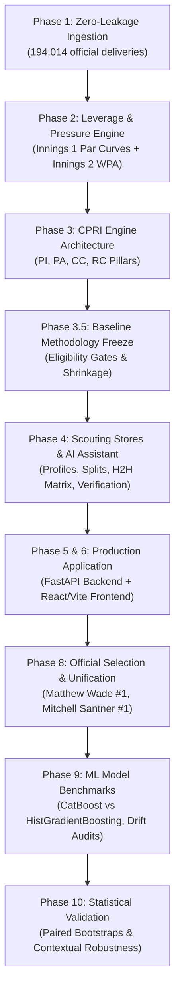

# SupeRR Intelligence — Documentation & Methodology Archive

Welcome to the comprehensive methodology documentation for **SupeRR Intelligence**, developed for the **SupeRR Selector Season 2 (Round 1)** analytics competition.

---

## 1. Documentation Index

The methodology and scientific audits of this project are organized into dedicated documentation records under [`docs/methodology/`](methodology/):

| Document | Primary Focus | Methodology Milestone |
| :--- | :--- | :---: |
| [`ADAPTABILITY_FORMULA_AND_SENSITIVITY.md`](methodology/ADAPTABILITY_FORMULA_AND_SENSITIVITY.md) | Calibrated PA formulation ($0.60 \cdot \text{PI} + 0.40 \cdot \max(\Delta, -5.0)$), effective 55% weight breakdown, and $\pm 5$ pt weight sensitivity tables. | **Phase 8** |
| [`PHASE_8_OFFICIAL_SELECTION_REPORT.md`](methodology/PHASE_8_OFFICIAL_SELECTION_REPORT.md) | Official Phase 8 submission rankings, selection justification, and candidate pool review. | **Phase 8 (Official Freeze)** |
| [`PHASE_8_FINAL_METHODOLOGY_REPORT.md`](methodology/PHASE_8_FINAL_METHODOLOGY_REPORT.md) | Complete mathematical specification of CPRI v1.0, Bayesian shrinkage parameters, and format normalizations. | **Phase 8** |
| [`PHASE_3_5_FREEZE_REPORT.md`](methodology/PHASE_3_5_FREEZE_REPORT.md) | Initial baseline methodology freeze and eligibility criteria. | **Phase 3.5** |
| [`PHASE_9_2_TEMPORAL_ROBUSTNESS_REPORT.md`](methodology/PHASE_9_2_TEMPORAL_ROBUSTNESS_REPORT.md) | ML model benchmarking, temporal drift investigation (2022–2025 vs 2026), and chronological split validation. | **Phase 9.2** |
| [`PHASE_10_FINAL_ASSESSMENT_REPORT.md`](methodology/PHASE_10_FINAL_ASSESSMENT_REPORT.md) | Final validation of Phase 8 Top 10 credibility, paired bootstrap tests, and format-conditioned expected-performance adjustments. | **Phase 10** |
| [`PHASE_10_METHODOLOGY_AND_SCOPE.md`](methodology/PHASE_10_METHODOLOGY_AND_SCOPE.md) | Detailed verification of dual-format data coverage and sample size distributions. | **Phase 10** |

---

## 2. Project Lifecycle Summary (Phases 1–10)

---

## 3. Official Competition Submission (Phase 8 Frozen Baseline)

### Official Top 10 Batters

| Rank | Player | Unified CPRI | 90% Bootstrap CI | Confidence Tier | Evidence Scope | Pressure Balls |
| :---: | :--- | :---: | :---: | :---: | :---: | :---: |
| **1** | **Matthew Wade** | **85.36** | [1, 22] | Exploratory | Dual-Format | 191 |
| **2** | **Tim David** | **82.44** | [1, 19] | High Confidence | Dual-Format | 476 |
| **3** | **Suryakumar Yadav** | **81.42** | [2, 25] | High Confidence | Dual-Format | 749 |
| **4** | **Reeza Hendricks** | **77.45** | [2, 49] | High Confidence | Dual-Format | 378 |
| **5** | **Rinku Singh** | **77.18** | [1, 51] | High Confidence | Dual-Format | 457 |
| **6** | **Phil Salt** | **76.96** | [2, 46] | High Confidence | Dual-Format | 261 |
| **7** | **Romario Shepherd** | **75.33** | [2, 47] | High Confidence | Dual-Format | 428 |
| **8** | **Namboori Tilak Varma** | **74.81** | [3, 49] | High Confidence | Dual-Format | 777 |
| **9** | **Dinesh Karthik** | **74.54** | [3, 44] | High Confidence | Dual-Format | 277 |
| **10** | **Ravindra Jadeja** | **73.70** | [3, 56] | High Confidence | Dual-Format | 467 |

### Official Top 10 Bowlers

| Rank | Player | Unified CPRI | 90% Bootstrap CI | Confidence Tier | Evidence Scope | Pressure Balls |
| :---: | :--- | :---: | :---: | :---: | :---: | :---: |
| **1** | **Mitchell Santner** | **79.84** | [2, 36] | High Confidence | Dual-Format | 653 |
| **2** | **Sufiyan Muqeem** | **78.78** | [1, 74] | Exploratory | T20I-Only | 151 |
| **3** | **Rashid Khan** | **77.90** | [2, 33] | High Confidence | Dual-Format | 970 |
| **4** | **Jamie Overton** | **76.92** | [1, 71] | Exploratory | T20I-Only | 168 |
| **5** | **Matheesha Pathirana** | **75.77** | [4, 49] | High Confidence | IPL-Only | 557 |
| **6** | **Sunil Narine** | **75.63** | [3, 52] | High Confidence | Dual-Format | 511 |
| **7** | **Mohammad Nawaz** | **75.51** | [2, 60] | High Confidence | Dual-Format | 301 |
| **8** | **Jasprit Bumrah** | **73.36** | [3, 67] | High Confidence | Dual-Format | 606 |
| **9** | **Varun Chakravarthy** | **73.02** | [3, 68] | High Confidence | Dual-Format | 892 |
| **10** | **Yuzvendra Chahal** | **73.01** | [3, 48] | High Confidence | Dual-Format | 859 |
